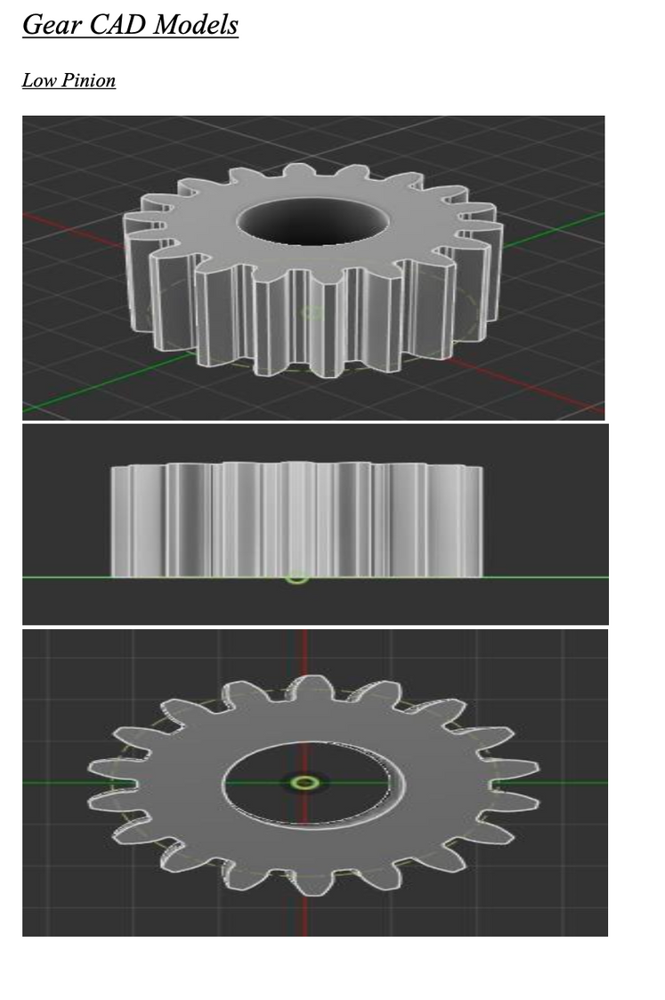
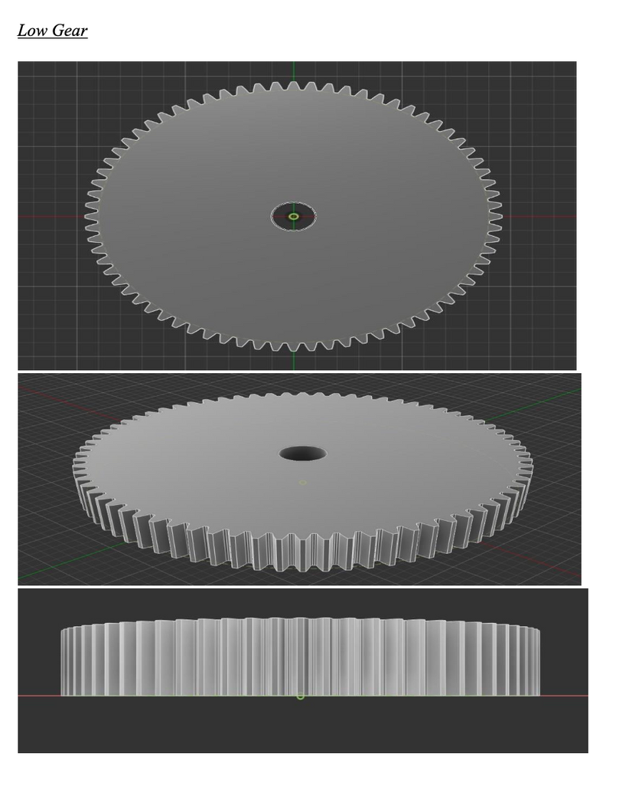
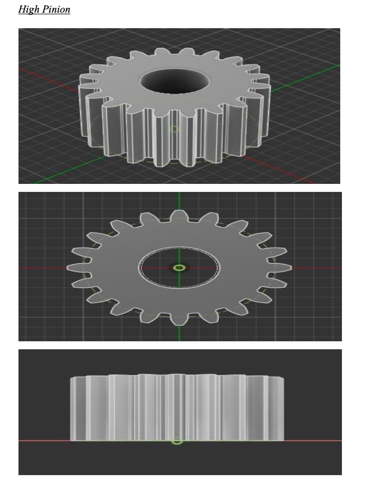
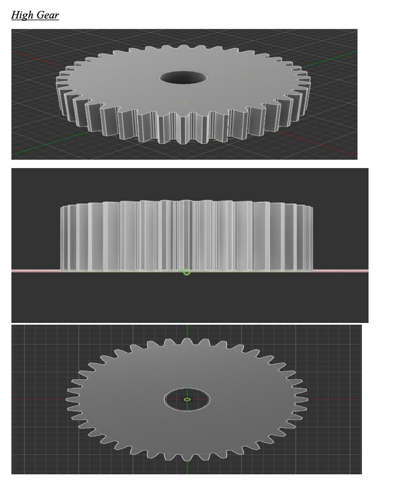

# Two-Speed Gearbox for a Small Electric Vehicle

Machine Design-II group project, Shiv Nadar University.

## My contribution
Group project. My part: gear design and SolidWorks CAD.

## Design inputs
- Motor: 20 kW, 6000 rpm
- Ratios: 4:1 (low gear, launch and hill climb) and 2:1 (high gear, cruising)
- Spur gears, module 2.5 mm, face width 25 mm, 20 degree pressure angle
- Tooth counts: 18/72 (low stage), 20/40 (high stage), chosen to avoid undercut
- Material considered: 20MnCr5 case-hardened steel

## Method
Input torque from power and speed, tangential and radial forces, pitch-line velocity and velocity factor, effective load with service factor 1.25, then Lewis bending and Buckingham wear checks.

## CAD models
| Low pinion (18T) | Low gear (72T) | High pinion (20T) | High gear (40T) |
|---|---|---|---|
|  |  |  |  |

## Status
Academic design project. No test or performance results were supplied for this page, so none are claimed.
